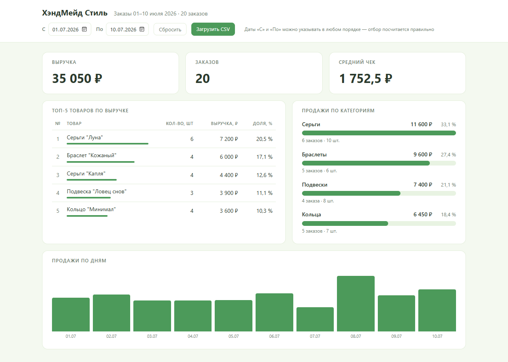
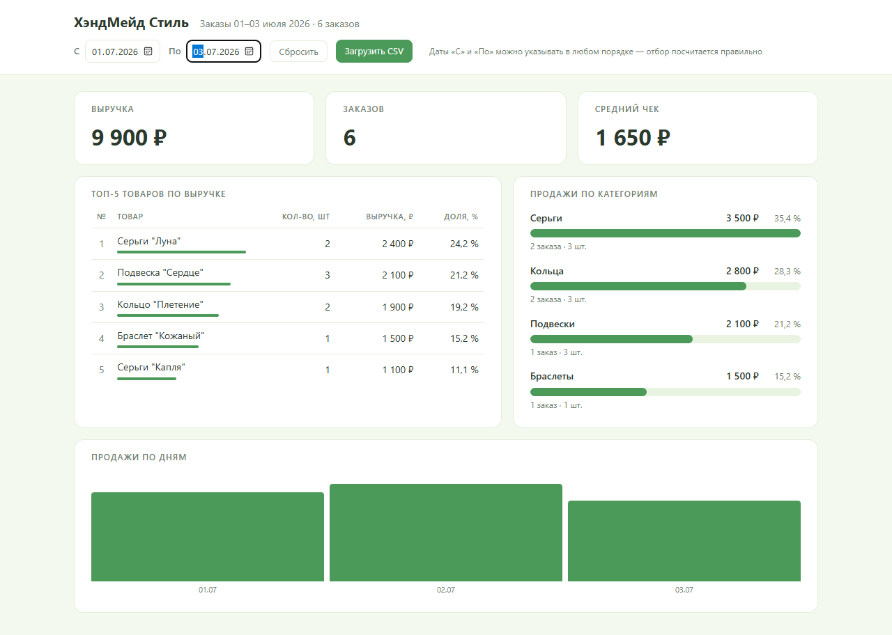
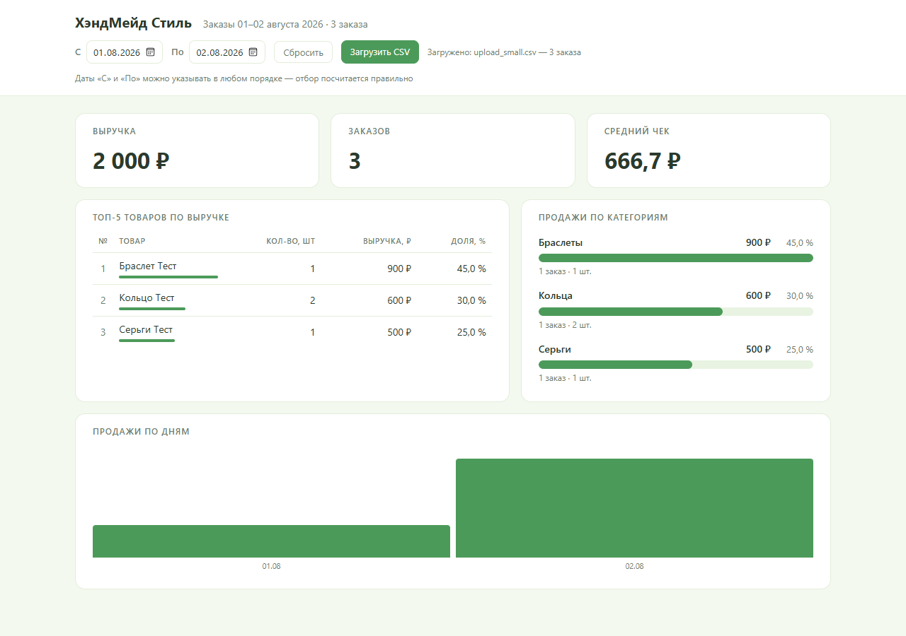

# Дашборд заказов «ХэндМейд Стиль»

Статичный веб-дашборд для интернет-магазина украшений ручной работы: выгрузка заказов в CSV превращается в экран с выручкой, топом товаров, продажами по категориям и динамикой по дням.
Работает офлайн — открывается двойным щелчком по `app/index.html`, без сервера, сборки, npm и интернета.

> **Кейс для портфолио:** задача, контекст, скриншоты и результат — в папке [`case/`](case/) (готовая HTML-страница кейса).



---

## Содержание

- [Задача и решение](#задача-и-решение)
- [Возможности](#возможности)
- [Быстрый старт](#быстрый-старт)
- [Формат данных](#формат-данных)
- [Как заменить данные](#как-заменить-данные)
- [Фильтр по датам и загрузка CSV](#фильтр-по-датам-и-загрузка-csv)
- [Контрольные значения и приёмка](#контрольные-значения-и-приёмка)
- [Стек и архитектура](#стек-и-архитектура)
- [Структура репозитория](#структура-репозитория)
- [Ветки](#ветки)
- [Материалы проекта](#материалы-проекта)

---

## Задача и решение

**Задача.** Владелец маленького магазина ведёт заказы в Excel и хочет за секунды видеть итоги: сколько заработали, что продаётся лучше, какая категория основная, есть ли рост по дням.
Готовые BI-системы тяжёлые, платные и требуют подключения данных.

**Решение.** Одностраничный статичный дашборд на чистых HTML + CSS + JavaScript:

- читает выгрузку заказов в формате CSV (из `data.js` или загруженную кнопкой);
- считает все показатели из одного агрегата — суммы по категориям, товарам и дням всегда сходятся;
- показывает понятные сообщения, если в данных ошибка или за период заказов нет.

**Результат.** Заказчик заполняет шаблон Excel, сохраняет CSV и получает ответы на четыре вопроса о продажах за 10 секунд. Работает на `file://` в любом современном браузере, включая мобильные.

| Фильтр по датам | Загрузка своего CSV |
|---|---|
|  |  |

---

## Возможности

**Ключевые показатели (карточки)**
- Выручка (`Σ total`), количество заказов (`count distinct order_id`), средний чек;
- форматирование: `35 050 ₽`, `1 752,5 ₽`; при нуле заказов средний чек = `0 ₽`, не `NaN`.

**Топ-5 товаров по выручке**
- колонки: №, товар, количество, выручка, доля в %;
- сортировка по выручке убывающе; ничья решается по числу заказов, затем по названию.

**Продажи по категориям**
- 4 полосы с суммой, долей, числом заказов и единиц; сортировка по выручке.

**Динамика по дням**
- столбчатый график по каждой дате периода, сумма за день.

**Фильтр по диапазону дат**
- поля «С» / «По» пересчитывают все блоки; даты можно указывать в любом порядке — диапазон нормализуется автоматически;
- кнопка «Сбросить» возвращает весь период выгрузки.

**Загрузка своего CSV кнопкой**
- файл проверяется по тем же правилам, что и данные в `data.js`;
- ошибка → красный баннер с описанием, текущие данные остаются;
- успех → данные заменяются, фильтр сбрасывается на период нового файла.

**Устойчивость к плохим данным**
- расхождение `total ≠ quantity × price` → жёлтый баннер с номерами заказов, расчёт продолжается по `total`;
- пустой период → состояние «Нет заказов за период», без падений JS;
- ошибка чтения/разбора → баннер вместо пустого экрана.

---

## Быстрый старт

```bash
git clone https://github.com/loparenok01-cpu/handmade-style-dashboard.git
cd handmade-style-dashboard
```

Дальше — без терминала: откройте **`app/index.html`** двойным щелчком в Chrome / Firefox / Edge.

Установка чего-либо не нужна. Демо-данные (20 заказов за 01–10 июля 2026) подключены по умолчанию.

---

## Формат данных

Одна строка CSV = один заказ. Обязательная первая строка — заголовки:

```
order_id,date,product,category,quantity,price,total
```

| Поле | Тип | Правило |
|---|---|---|
| `order_id` | число | уникальный номер заказа; одинаковые номера считаются одним заказом |
| `date` | `ГГГГ-ММ-ДД` | группировка по дням и период в шапке |
| `product` | строка | ключ группировки топа товаров |
| `category` | строка | ключ группировки по категориям |
| `quantity` | число | количество единиц (не заказов) |
| `price` | число | цена единицы, ₽ |
| `total` | число | сумма заказа, ₽; **единственный источник выручки**, должно быть `quantity × price` |

Правила обработки: дедупликация по `order_id`; неизвестная категория попадает в «Прочее»; период шапки вычисляется из `min(date)` и `max(date)`.

Пример выгрузки — [`app/orders-sample.csv`](app/orders-sample.csv).

---

## Как заменить данные

Готовый шаблон для заполнения — [`docs/шаблон_заказов.xlsx`](docs/шаблон_заказов.xlsx):
заполните лист «Заказы» по образцу и сохраните файл как CSV UTF-8 с разделителем-запятой (шаги описаны на листе «Инструкция»).

**Способ 1 — через `data.js`:**

1. Откройте `app/data.js` в Блокноте.
2. Удалите всё содержимое между обратными кавычками (там лежит старая выгрузка).
3. Вставьте текст своего CSV-файла.
4. Сохраните файл и обновите страницу дашборда (F5).

**Способ 2 — кнопкой:** нажмите «Загрузить CSV» под шапкой и выберите файл.
Файл проверяется по тем же правилам; при ошибке появится красный баннер, а текущие данные сохранятся.

---

## Фильтр по датам и загрузка CSV

- поля «С» / «По» под шапкой ограничивают период для **всех** блоков: карточек, топа, категорий, графика по дней;
- порядок дат не важен: «С = 10 июля, По = 1 июля» отработает корректно;
- «Сбросить» возвращает полный период выгрузки;
- если формат даты непонятен браузеру — красный баннер с описанием.

---

## Контрольные значения и приёмка

На демо-выгрузке из 20 заказов (01–10 июля 2026):

| Метрика | Значение |
|---|---|
| Выручка | **35 050 ₽** |
| Заказов | **20** |
| Средний чек | **1 752,5 ₽** |
| Продано единиц | 31 |
| Сходимость | Σ категорий = Σ товаров = Σ по дням = 35 050 ₽ |

Чек-лист приёмки (полностью — в [`docs/ТЗ_DashBoard.md`](docs/ТЗ_DashBoard.md), раздел 8):

- [x] Все обязательные блоки отображаются при открытии `index.html` двойным щелчком;
- [x] выручка, заказы и средний чек совпадают с контрольными значениями;
- [x] топ-5 и категории отсортированы по убыванию выручки;
- [x] суммы сходятся на любом срезе фильтра, доли категорий дают 100 %;
- [x] пустые данные и 0 заказов не роняют JS;
- [x] в консоли браузера нет ошибок при штатной загрузке;
- [x] адаптив: на экране уже 700 px блоки складываются в одну колонку.

---

## Стек и архитектура

**Стек:** HTML + CSS + vanilla JavaScript. Без фреймворков, сборщиков, npm и CDN — всё работает офлайн на `file://`.

**Поток данных** (три шага, один источник истины):

```
CSV-строка → loadOrders() → массив нормализованных заказов
          → aggregate(orders) → объект состояния со всеми метриками
          → render(state) → заполнение всех блоков экрана
```

| Файл | Роль |
|---|---|
| `app/index.html` | разметка экрана: шапка с фильтром, карточки, панели |
| `app/app.js` | CSV-парсер, валидация, агрегация, форматирование, рендер, обработчики |
| `app/data.js` | выгрузка заказов (CSV-строка в обратных кавычках) |
| `app/styles.css` | стили, полосы категорий, график по дням, адаптив |
| `app/orders-sample.csv` | демо-выгрузка на 20 заказов |

Ключевое требование: **все блоки считаются из одного агрегата** — поэтому любые срезы фильтра внутренне согласованы.

---

## Структура репозитория

```
handmade-style-dashboard/
├── README.md                 # это описание
├── .gitignore
├── app/                      # сам дашборд (открывать index.html)
│   ├── index.html
│   ├── styles.css
│   ├── app.js
│   ├── data.js
│   └── orders-sample.csv
├── docs/                     # документация проекта
│   ├── ТЗ_DashBoard.md       # техническое задание + критерии приёмки
│   └── шаблон_заказов.xlsx   # шаблон для заполнения заказами
├── delivery/                 # готовая копия для передачи заказчику (8 файлов)
│   ├── index.html, styles.css, app.js, data.js
│   ├── README.md, ТЗ_DashBoard.md
│   ├── шаблон_заказов.xlsx, orders-sample.csv
└── case/                     # кейс для портфолио
    ├── Кейс_ХэндМейд_Стиль.html   # готовый кейс с картинками
    ├── dashboard-case.html        # компактная версия кейса
    ├── case-template.html         # шаблон кейса для других проектов
    ├── reference-example.html     # заполненный пример для ориентира
    ├── style.css, ЗАПУСК.md
    └── shot-*.png, Portfolio site.png
```

`delivery/` — автономная копия: в ней ровно те восемь файлов, которые получает заказчик, путей наружу нет.

---

## Ветки

| Ветка | Назначение |
|---|---|
| `main` | стабильный релиз — то, что смотрит заказчик и портфолио |
| `develop` | интеграционная ветка: сюда собираются все изменения перед релизом |
| `refactor/project-structure` | иерархия репозитория: `app/`, `docs/`, `delivery/`, `case/` |
| `docs/portfolio-readme` | описание проекта: этот README |
| `chore/repo-hygiene` | чистка репозитория: служебные файлы вне индекса, ссылки на проект |

Рабочий процесс: изменение → ветка `feature/*`, `docs/*` или `chore/*` → `develop` → после проверки `main`.
Все ветки опубликованы в репозитории, история читается как последовательность этапов проекта.

---

## Материалы проекта

- **[`docs/ТЗ_DashBoard.md`](docs/ТЗ_DashBoard.md)** — техническое задание: цели, границы MVP, формулы метрик, макет, состояния интерфейса, критерии приёмки, что сделано в версии 2.
- **[`delivery/`](delivery/)** — пакет для заказчика: дашборд + инструкции + шаблон + пример выгрузки.
- **[`case/`](case/)** — кейс портфолио: задача, аудитория, проблема, решение, инструменты, результат и скриншоты; `ЗАПУСК.md` объясняет, как перенести шаблон кейса на другой проект.

---

## Контакты

**Елена Лопарева** · почта: [l6344@list.ru](mailto:l6344@list.ru) · GitHub: [@loparenok01-cpu](https://github.com/loparenok01-cpu)
